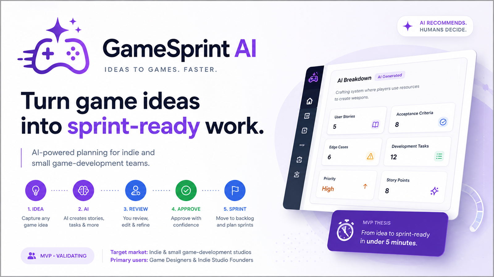

# GameSprint AI – Product Management Case Study

  

An AI-powered product-planning MVP designed to help indie and small game-development teams turn game ideas into sprint-ready work.

This project was developed as part of the **Ironhack AI Product Manager Bootcamp**.

> 📄 **Quick Links:** [PRD](docs/GameSprint%20AI%20%E2%80%94%20Product%20Requirements%20Document%20(PRD).pdf) • [Slide Presentation](https://www.figma.com/proto/nRxc0bhcarxf49JPgvDKFb/GameSprint-AI-%E2%80%94-Design-System-1.0?node-id=7870-10&p=f&t=iNSoHcMx1epxp1dj-1&scaling=contain&content-scaling=fixed&page-id=7870%3A5) • [Live MVP](https://lovable.dev/preview/kmLD5kvuTbXOlfhIx3HY7jpvAlIAjegE)

---

## 📑 Table of Contents

- [🚀 Project Overview](#-project-overview)
- [🎯 Problem Statement](#-problem-statement)
- [💡 Proposed Solution](#-proposed-solution)
- [👤 Target Users](#-target-users)
- [🧱 MVP Scope](#-mvp-scope)
- [📊 Success Metrics](#-success-metrics)
- [🎨 Product Experience](#-product-experience)
- [🤖 Responsible AI](#-responsible-ai)
- [🎨 Slide Presentation](#-slide-presentation)
- [📄 Project Deliverables](#-project-deliverables)
- [🛠 Product Management Skills Demonstrated](#-product-management-skills-demonstrated)
- [🧰 Tools Used](#-tools-used)
- [📸 Project Preview](#-project-preview)
- [📚 About this Project](#-about-this-project)
- [💭 Reflection](#-reflection)
- [👥 Team](#-team)

---

## 🚀 Project Overview

GameSprint AI is an AI-powered web application designed for **indie and small game-development teams**.

The product focuses on the gap between having a game idea and turning that idea into structured development work.

The core workflow is:

**Game Idea → AI Breakdown → Human Review → Backlog → Sprint → Development**

Rather than replacing established project-management platforms such as Jira or Trello, GameSprint AI focuses on a more specific problem:

> **How can we help a small game-development team turn a raw idea into useful, reviewed, sprint-ready work faster?**

The product is designed around a simple principle:

> **AI recommends. Humans decide.**

The AI provides an initial structured breakdown, while the human remains responsible for reviewing, editing and approving the final requirements.

---

## 🎯 Problem Statement

A game feature often starts as a high-level idea.

For example:

> "We need a crafting system where players can use resources to create weapons."

Although the idea communicates what the team wants to build, it still needs to be translated into actionable development work.

The team may need to define:

- User stories
- Acceptance criteria
- Edge cases
- Development tasks
- Priority
- Story-point estimates
- Sprint placement

For small teams, this translation can require significant time and collaboration between game design, product and development.

Existing tools are effective at organizing and tracking work **once it has been defined**, but they are not primarily designed to solve the initial transformation from:

**Game Design → Product Management → Development**

### The opportunity

GameSprint AI explores how AI can provide a structured first pass of this process while keeping the human decision-maker in control.

The proposed workflow is:

**Raw Game Idea → AI Breakdown → Human Review → Approved Requirements → Backlog → Sprint**

---

## 💡 Proposed Solution

GameSprint AI helps small game-development teams transform a natural-language game idea into structured development requirements.

The AI can generate:

- User stories
- Acceptance criteria
- Edge cases
- Development task suggestions
- Priority recommendations
- Story-point estimates
- Potential sprint recommendations

The generated content can then be:

**Generated → Reviewed → Edited → Regenerated → Approved**

Only after human approval can the work move into the backlog and sprint workflow.

The goal is not to make AI autonomous.

The goal is to reduce the manual effort involved in turning an idea into something the development team can actually build.

---

## 👤 Target Users

The primary target market is **indie and small game-development studios**, particularly teams of approximately 2–20 people.

### Primary Users

**Game Designers**

People who need to translate gameplay concepts and mechanics into implementable development requirements.

**Indie Studio Founders**

People who often combine creative, product and project responsibilities and need lightweight tools to structure development work.

### Secondary Users

- Game Producers
- Product Owners
- Project Managers

---

## 🧱 MVP Scope

The MVP was intentionally focused on validating the core AI value proposition rather than becoming another full project-management platform.

### Core AI Capabilities

- Game idea analysis
- User story generation
- Acceptance criteria generation
- Edge-case identification
- Development task suggestions
- Priority recommendations
- Story-point recommendations
- AI output review and regeneration

### Platform Capabilities

- Authentication
- Project creation
- Project dashboard
- Feature / idea creation
- AI generation interface
- AI output review and editing
- Backlog management
- Backlog item creation from approved AI output
- Sprint creation
- Sprint assignment
- Basic task status
- Basic team management
- Onboarding

### Intentionally Out of Scope

The MVP does not attempt to provide:

- Full Jira/Trello replacement
- Advanced resource management
- Advanced reporting
- Complex collaboration features
- Game-engine integrations
- Autonomous project management
- Automatic approval of AI-generated requirements
- Fully autonomous sprint planning

This prioritisation follows one principle:

> **Build only what is necessary to validate the core AI value proposition.**

---

## 📊 Success Metrics

The MVP was designed around two primary success metrics.

### AI-to-Sprint Conversion Rate

**Target: ≥60%**

At least 60% of AI-generated features should ultimately be approved and assigned to a sprint.

This measures whether the AI output is useful enough to become real development work.

### Time to Sprint-Ready

**Target: <5 minutes**

A user should be able to describe a feature, generate the AI breakdown, review and edit the output, and prepare the feature for sprint planning in under five minutes.

The metric deliberately includes human review.

The objective is not simply faster AI generation — it is reducing the total time required to produce useful, human-approved development work.

---

## 🎨 Product Experience

The product experience was designed around a lightweight workflow rather than a traditional enterprise project-management interface.

The core experience moves the user through:

1. **Create a game idea**
2. **Generate an AI breakdown**
3. **Review the generated requirements**
4. **Edit or regenerate content**
5. **Approve the requirements**
6. **Add the work to the backlog**
7. **Assign work to a sprint**
8. **Track basic sprint progress**

The product's visual system uses distinct colours and states to communicate the difference between:

- AI-generated recommendations
- Human-created content
- Review states
- Approved work
- Errors and warnings

The Figma design system covers the product foundations, components, application shell, AI workflow, backlog, sprint experiences, states and core screens.

---

## 🤖 Responsible AI

Responsible AI was considered part of the product design rather than an implementation detail.

The core principle is:

> **AI recommends. Humans decide.**

### Human-in-the-Loop

AI-generated requirements must be reviewed and explicitly approved before becoming committed development work.

### Transparency

The interface should clearly distinguish AI-generated content from user-created or user-edited content.

### Avoiding Overconfidence

The system treats:

- Priorities as recommendations
- Story points as estimates
- Requirements as drafts
- Edge cases as potential considerations
- Sprint recommendations as suggestions

### User Control

Users can:

- Edit AI-generated content
- Regenerate individual outputs
- Reject suggestions
- Approve final requirements
- Correct AI-generated information

The system should never make irreversible project decisions autonomously.

---

## 🎨 Slide Presentation

The complete product story is presented through a slide presentation covering the main Product Management decisions behind GameSprint AI.

The presentation includes:

- Executive Summary
- Problem & Opportunity
- User Persona
- Core Loop
- Product Experience
- Competition
- MVP Scope
- Responsible AI
- Architecture
- Success Metrics
- Roadmap & Business Direction
- CEO Decision

### 🔗 Presentation

[Open the GameSprint AI Slide Presentation](https://www.figma.com/proto/nRxc0bhcarxf49JPgvDKFb/GameSprint-AI-%E2%80%94-Design-System-1.0?node-id=7870-10&p=f&t=iNSoHcMx1epxp1dj-1&scaling=contain&content-scaling=fixed&page-id=7870%3A5)

---

## 📄 Project Deliverables

### Product Requirements Document (PRD)

[View the Product Requirements Document](docs/GameSprint%20AI%20%E2%80%94%20Product%20Requirements%20Document%20(PRD).pdf)

The PRD defines:

- Product context
- Discovery
- Problem and opportunity
- Product vision
- Competitor analysis
- User persona
- Prioritisation
- Requirements and scope
- Success metrics
- Risks and dependencies
- Responsible AI
- Security and privacy
- Roadmap
- MVP definition
- Business model and monetisation

### Product & Design System

[View the Product & Design System](docs/GameSprint_AI_Product_and_Design_System.md)

Documents the product's visual language, UX principles, components, patterns and product experience.

### Architecture Overview

[View the Architecture Overview](docs/GameSprint_AI_Architecture_Overview.md)

Documents the proposed technical architecture, AI orchestration, data boundaries, security principles and scalability considerations.

### Figma Design System

[View the Figma Design System source](design/GameSprint_AI_Design_System.fig)

---

## 🛠 Product Management Skills Demonstrated

This project demonstrates practical Product Management skills including:

- Product Vision & Strategy
- Problem Definition
- Discovery
- Competitor Analysis
- User Persona Development
- MVP Definition
- Feature Prioritisation
- Requirements Definition
- User Stories
- Acceptance Criteria
- Product Metrics
- Responsible AI
- Product Roadmapping
- Business Model Thinking
- Agile / Scrum Planning
- UX & Product Design Collaboration
- Stakeholder Presentation

---

## 🧰 Tools Used

- **Figma** – Product & UX/UI Design
- **ChatGPT** – AI-assisted Product Management
- **Lovable** – MVP Development

AI was used throughout the project to support product research, ideation, documentation, requirements refinement and MVP development.

---

## 📸 Project Preview

The repository contains the main artefacts produced during the project:

- Product Requirements Document
- Product & Design System
- Architecture Overview
- Figma Design System
- Slide Presentation
- Working MVP
- Brand Identity

### 🚀 Live MVP

[Open GameSprint AI](https://lovable.dev/preview/kmLD5kvuTbXOlfhIx3HY7jpvAlIAjegE)

---

## 📚 About this Project

GameSprint AI was developed as a **school project during the Ironhack AI Product Manager Bootcamp**.

The objective was to apply Product Management practices to a realistic product challenge and develop an AI-powered MVP from problem definition through product strategy, prioritisation, design and implementation.

The project combines:

- Product Management
- Game Development workflows
- Agile / Scrum
- UX/UI Design
- Artificial Intelligence
- AI-assisted MVP development

The project is presented as an **MVP case study**, not as a commercially launched product.

---

## 💭 Reflection

This project allowed us to explore how AI could be applied to a specific Product Management problem within the game-development industry.

One of the most important decisions was to avoid building another generic project-management platform. Existing tools already provide strong backlog, sprint and project-management capabilities. Instead, we focused the MVP on the specific transition from:

**"What do we want to build?" → "What exactly needs to be developed?"**

Another important product decision was maintaining a strong human-in-the-loop approach. AI-generated requirements, priorities and estimates are recommendations rather than final decisions. The user remains responsible for reviewing and approving the work.

The MVP is intentionally only the beginning. The next step would be to validate the product with real Game Designers and small game-development teams, focusing on the two primary success metrics:

- **AI-to-Sprint Conversion Rate ≥60%**
- **Time to Sprint-Ready <5 minutes**

The results of that validation would determine whether to expand into deeper collaboration, integrations and more advanced AI-powered product-management capabilities.

---

## 👥 Team

This project was developed collaboratively by:

- **Jose Manuel Lozano** – [LinkedIn](https://www.linkedin.com/in/jose-manuel-lozano-barba/?locale=en-US) · [GitHub](https://github.com/joselozano-pm)
- **Oluwagbemiga Adeniyi (Sola)** – [LinkedIn](https://www.linkedin.com/in/oluwagbemiga-adeniyi-06657b86/) · [GitHub](https://github.com/DDarsh100)

---

**GameSprint AI** · *Ideas to Games. Faster.*
